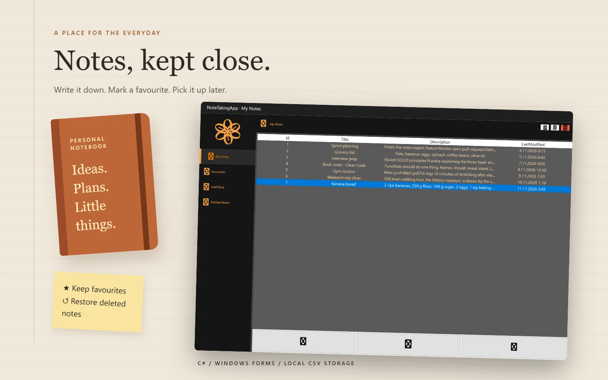
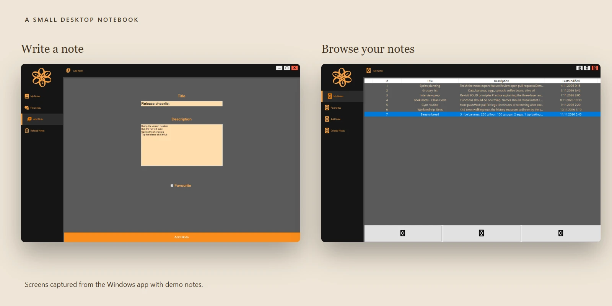

<div align="center">

# NoteTakingApp

**A local desktop notebook for ideas, favourites and everyday plans.**

   

[Screenshots](#screenshots) · [Getting started](#getting-started)



</div>

## Overview

NoteTakingApp is a Windows Forms notebook with a dark interface and orange accents. Create notes with a title and description, edit them later, mark favourites, and browse deleted notes before restoring or permanently removing them.

Notes live in local CSV files. The application is organised into presentation, business-logic and data-access projects, keeping the forms separate from the note operations and file storage.

## Features

| Keep the useful things | Manage the lifecycle |
| --- | --- |
| **Create and edit notes** with titles and descriptions | **Delete to a separate collection** |
| **Mark favourites** and browse them in a dedicated view | **Restore or permanently delete** a selected note |
| **Last-modified timestamps** alongside the note list | **Local CSV persistence** without a server account |

## Screenshots



The notebook composition uses real application captures with demo notes. The app's current icon-rendering limitations remain visible in the screenshots.

## Getting started

Requires **Windows**, a .NET SDK that can build `net7.0-windows`, and the **.NET 7 Windows Desktop Runtime** for the default executable. Visual Studio 2022 with the **.NET desktop development** workload is another way to open the solution.

Run in PowerShell from a fresh clone:

```powershell
git clone https://github.com/HHChandar20/NoteTakingApp.git
cd NoteTakingApp
dotnet restore .\NoteTakingApp\NoteTakingApp.sln
dotnet build .\NoteTakingApp\NoteTakingApp.sln --configuration Debug
cd .\NoteTakingApp\NoteTakingApp.PL\bin\Debug\net7.0-windows
.\NoteTakingApp.PL.exe
```

Launch from the output directory shown above. The application expects its CSV files at a relative path back into `NoteTakingApp.DAL/Data/`; launching from another working directory can prevent them from loading. Keep `Notes_Data.csv` and `Deleted_Notes_Data.csv` in place, and use a separate clone when trying demo notes.

The isolated demo copy builds with the .NET 9 SDK. The SDK warns about the .NET 7 target and MetroModernUI's legacy framework compatibility. Some icon glyphs also render as missing characters on the capture machine.

## Tech stack

C# · .NET 7 · Windows Forms · FontAwesome.Sharp · MetroModernUI · Local CSV files

## License

[MIT](LICENSE).

Built by [Hakan Chandar](https://github.com/HHChandar20) · 2023.
